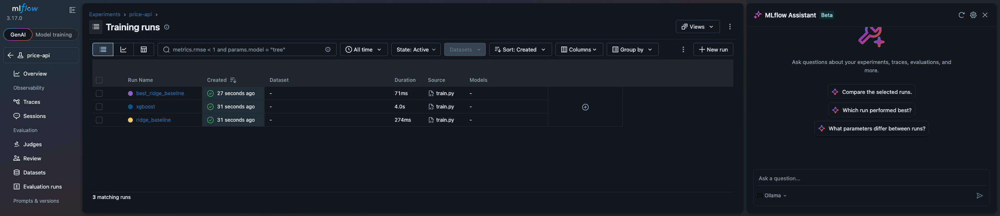

# price-api

A small price-prediction API for retail / e-commerce products, packaged with Docker and deployed to
Google Cloud Run by a GitHub Actions pipeline. **The model is deliberately simple: the point of the
project is the deployment path** (Docker, FastAPI, CI/CD, MLflow, pytest, GCP).

Given a product's shop, brand, category, title, user rating and number of reviews, `POST /predict` returns a
predicted price and a 90 % prediction interval `[low, high]`.

- **Demo URL:** _TODO: paste the Cloud Run URL here after the first deploy_
- **MLflow UI:** 

## Architecture

```
                 python -m src.train (local / container)
 Zenodo CSV ───►  ├─ baseline Ridge ──┐   MLflow (local SQLite,
 (CC BY 4.0)      ├─ XGBoost ─────────┼─► params + metrics per run)
                  └─ best model + split-conformal quantile
                                      │
                                      ▼
                            models/model.joblib   (committed, < 1 MB)
                                      │
 git push ──► GitHub Actions ─────────┤
              ├─ pytest (every push / PR)
              └─ main only: docker build ─► Artifact Registry ─► Cloud Run
                                      │
                                      ▼
                   FastAPI  GET /health · POST /predict
                   (loads model.joblib only, never MLflow)
```

## Dataset

- **Source:** ComponentesPC_Scraper, scraped from pccomponentes.com and pcbox.com by J. Lopez Calderon
  and J. M. Cano Hernandez (UOC), [Zenodo record 4263453](https://zenodo.org/records/4263453).
- **License:** [CC BY 4.0](https://creativecommons.org/licenses/by/4.0/) (checked on the Zenodo record;
  the Kaggle mirror labels it CC0, which is not the original license). Attribution is required.
- **Why this dataset:**
  1. Real shop prices with a stable, scriptable download (Zenodo, SHA-256 checked in `src/data.py`).
  2. 7,673 scraped rows, 3,917 unique products after deduplication, with categorical (shop, brand,
     category), text (product title) and numeric (rating, reviews) features and a numeric target (`price`).
  3. Small enough (1.6 MB) to train in seconds, so the focus stays on the deployment.

The data is **not committed** (`data/` is git-ignored); it is downloaded on demand:

```bash
python -m src.data
```

`models/model.joblib` is committed so CI and the Docker build do not need the data.

## Run locally

Python 3.10 is used everywhere (venv, Docker image, CI).

```bash
python3.10 -m venv .venv && source .venv/bin/activate
pip install -r requirements-dev.txt
# macOS only: XGBoost needs the OpenMP runtime
brew install libomp   # skip if you only use Docker (see "Training" below)
uvicorn src.app:app --reload --port 8080
```

```bash
curl localhost:8080/health
curl -X POST localhost:8080/predict -H 'Content-Type: application/json' -d '{
  "company_name": "pccomponentes", "brand_name": "Gigabyte",
  "category": "Discos Duros", "name": "Gigabyte SSD M.2 512GB 2280 PCIe x2 NVMe",
  "score": 9.5, "reviews": 40}'
```

Interactive docs: <http://localhost:8080/docs>.

## Training

```bash
pip install -r requirements-train.txt
python -m src.train          # downloads the data if needed, writes models/model.joblib
mlflow ui --backend-store-uri sqlite:///mlflow.db   # http://localhost:5000
```

`src/train.py` splits the data 60 / 15 / 15 / 10 % (train / validation / calibration / test), trains a
Ridge baseline and an XGBoost regressor, logs parameters and metrics of each run in MLflow (local SQLite
file, no server), keeps the model with the lowest validation MAE, computes the split-conformal quantile
on the calibration set, and saves both in `models/model.joblib`. `mlflow.db` / `mlruns/` are git-ignored.

No `libomp` on your Mac? Train and test in a Linux container instead (same Python 3.10 as production).
Create a throwaway `Dockerfile.dev` outside the repo (or delete it afterwards):

```dockerfile
FROM python:3.10-slim
RUN apt-get update && apt-get install -y --no-install-recommends libgomp1 && rm -rf /var/lib/apt/lists/*
COPY requirements*.txt /tmp/
RUN pip install --no-cache-dir -r /tmp/requirements-train.txt -r /tmp/requirements-dev.txt
WORKDIR /work
```

```bash
docker build --platform linux/amd64 -t price-api-dev -f Dockerfile.dev .
docker run --rm -v "$PWD":/work price-api-dev python -m src.train
docker run --rm -v "$PWD":/work price-api-dev pytest -q
```


## Tests

```bash
pytest -q
```

Covers `/health`, `/predict` with a valid input, with invalid inputs (422), model loading, and
`low <= price <= high`.

## Docker (local build)

```bash
docker build --platform linux/amd64 -t price-api .
docker run --rm -p 8080:8080 price-api
# or on another port: docker run --rm -e PORT=9000 -p 9000:9000 price-api
```

The image is based on `python:3.10-slim`, runs as a non-root user, and listens on `$PORT` (default 8080).
On Linux the CPU-only `xgboost-cpu` wheel is used: the default XGBoost wheel adds ~800 MB of GPU libraries.

## One-time GCP setup

Run these yourself, once. Replace the placeholders (`PROJECT_ID`, region, etc.).

```bash
export PROJECT_ID=your-project-id
export REGION=europe-west1
export AR_REPO=price-api
export SERVICE=price-api
export SA=github-deployer

gcloud config set project $PROJECT_ID

# 1. Enable only the APIs needed. Do NOT enable Container Scanning (containerscanning.googleapis.com):
#    it bills per scanned image.
gcloud services enable run.googleapis.com artifactregistry.googleapis.com iam.googleapis.com \
  cloudresourcemanager.googleapis.com billingbudgets.googleapis.com

# 2. Artifact Registry repository
gcloud artifacts repositories create $AR_REPO \
  --repository-format=docker --location=$REGION --description="price-api images"

# 3. Service account for GitHub Actions, with minimal roles
gcloud iam service-accounts create $SA --display-name="GitHub Actions deployer"
SA_EMAIL=$SA@$PROJECT_ID.iam.gserviceaccount.com

# push images (scoped to this repository only)
gcloud artifacts repositories add-iam-policy-binding $AR_REPO --location=$REGION \
  --member="serviceAccount:$SA_EMAIL" --role="roles/artifactregistry.writer"
# create / update Cloud Run services
gcloud projects add-iam-policy-binding $PROJECT_ID \
  --member="serviceAccount:$SA_EMAIL" --role="roles/run.admin"
# The service runs as its own service account with NO roles (the API needs no GCP access), instead of the
# default compute account, which has the broad Editor role. The deployer may act as that account only.
gcloud iam service-accounts create price-api-runtime --display-name="price-api Cloud Run runtime (no roles)"
gcloud iam service-accounts add-iam-policy-binding \
  price-api-runtime@$PROJECT_ID.iam.gserviceaccount.com \
  --member="serviceAccount:$SA_EMAIL" --role="roles/iam.serviceAccountUser"

# 4. Key for GitHub (paste the file content into the GCP_SA_KEY secret, then delete the file)
gcloud iam service-accounts keys create gcp-key.json --iam-account=$SA_EMAIL

# 5. Budget alert (find your billing account id with `gcloud billing accounts list`;
#    the currency in --budget-amount must match the billing account's currency)
gcloud billing budgets create --billing-account=BILLING_ACCOUNT_ID \
  --display-name="price-api budget" --budget-amount=5EUR \
  --threshold-rule=percent=0.5 --threshold-rule=percent=0.9 --threshold-rule=percent=1.0
```

If `run.admin` feels too broad for you, a custom role with `run.services.get/create/update` and
`run.services.setIamPolicy` is enough; `--allow-unauthenticated` needs the latter.

### Artifact Registry cleanup: keep only the 3 latest images

```bash
cat > cleanup-policy.json <<'EOF'
[
  {"name": "keep-last-3", "action": {"type": "Keep"},
   "mostRecentVersions": {"keepCount": 3}},
  {"name": "delete-the-rest", "action": {"type": "Delete"},
   "condition": {"tagState": "any"}}
]
EOF
# dry run first: logs what would be deleted without deleting anything
gcloud artifacts repositories set-cleanup-policies $AR_REPO --location=$REGION \
  --policy=cleanup-policy.json --dry-run
# then apply for real (keep wins over delete when an image matches both policies).
# --no-dry-run is required: --dry-run stores the policies in "dry run" mode, which persists otherwise.
gcloud artifacts repositories set-cleanup-policies $AR_REPO --location=$REGION \
  --policy=cleanup-policy.json --no-dry-run
```

### GitHub configuration

In the repository, under *Settings → Secrets and variables → Actions*:

| Type     | Name             | Value                                      |
|----------|------------------|--------------------------------------------|
| Secret   | `GCP_SA_KEY`     | content of `gcp-key.json`                  |
| Variable | `GCP_PROJECT_ID` | your project id                            |
| Variable | `GCP_REGION`     | e.g. `europe-west1`                        |
| Variable | `GCP_SERVICE`    | Cloud Run service name, e.g. `price-api`   |
| Variable | `GCP_AR_REPO`    | Artifact Registry repo name, e.g. `price-api` |

The workflow `.github/workflows/ci-cd.yml` expects this repository's root to be the `price-api` folder.
Pushes and pull requests run the tests; a push to `main` also builds, pushes and deploys.

### Cost guardrails

Cloud Run is deployed with `--min-instances 0 --max-instances 2 --memory 512Mi` and the default
request-based billing, so an idle service costs nothing. The image is `python:3.10-slim` with only the
API requirements (no MLflow, no training tools). The service is public (`--allow-unauthenticated`) so the
demo URL works; remove that flag if you do not want it exposed.

## What the interval guarantees (and what it does not)

The `[low, high]` interval is **split conformal prediction**: `q` is the 90 % quantile of absolute errors
of the best model on a held-out calibration set (with the finite-sample correction), and the interval is
`price ± q` (lower bound floored at 0).

- **Guarantee:** if calibration and future data are exchangeable, the interval contains the true price
  with probability at least 90 % **on average over products** (marginal coverage).
- **Not guaranteed:**
  - *Conditional coverage.* The interval has the same width for every product, so it is too wide for cheap
    items and too narrow for expensive ones; coverage for a specific category or price range can be far
    from 90 %.
  - *Distribution shift.* The data is a 2020 scrape of two Spanish shops. Prices drift, so the guarantee
    does not hold for today's prices, other shops or other product types.
  - *Small calibration set.* About 580 calibration points, so the realised coverage fluctuates a few
    points around 90 %. The coverage measured on the test split is logged in MLflow and stored in the model file.
  - Unseen brands or categories are accepted (treated as unknown) but predictions for them are less reliable.

## Project layout

```
src/        data.py (download), train.py, app.py, schemas.py
models/     model.joblib
tests/      test_api.py
.github/    workflows/ci-cd.yml
```
